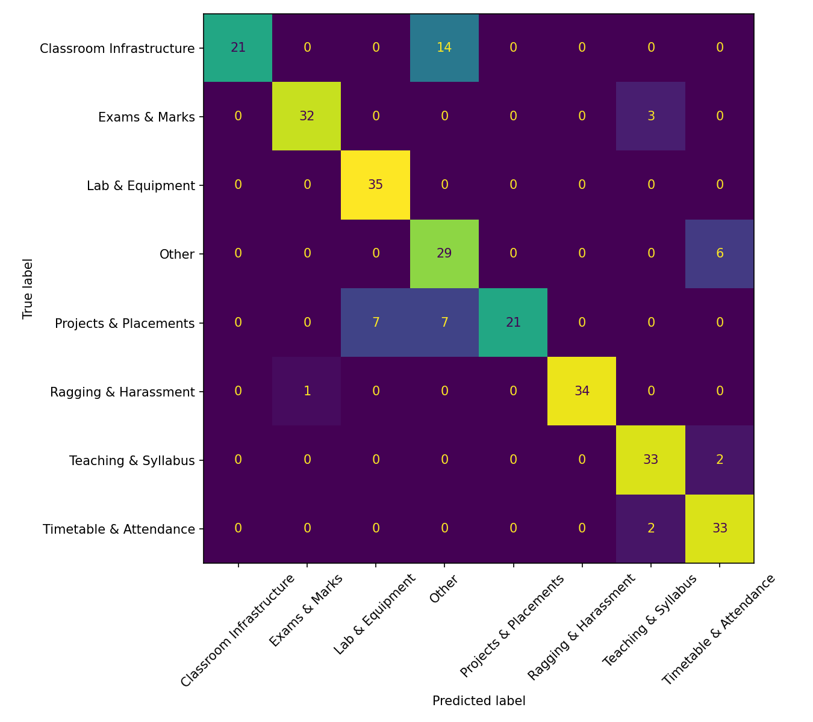

# AI Complaint Classification & Escalation System

> Students write a complaint in plain words. The system **classifies** it with NLP, sets its **priority**, **routes** it to the right coordinator, and **auto-escalates** it (Officer → HOD → Principal) if the deadline is missed.


## The problem
In a college department, complaints travel through WhatsApp, paper and word of mouth. They reach the wrong person, get lost, and nobody follows up. This project gives every complaint an owner and a deadline.

## Screenshots
<!-- Drag and drop your screenshots here while editing this file on GitHub -->
| Student complaint form | AI result (category + priority) |
|---|---|
| _add screenshot_ | _add screenshot_ |

| Officer dashboard | Admin dashboard |
|---|---|
| _add screenshot_ | _add screenshot_ |

## Features
- **AI classification:** TF-IDF + Logistic Regression assigns one of 8 categories, with explainable key terms.
- **Safe priority rules:** safety keywords (Critical / High / Medium / Low) always win over the model, so dangerous complaints are never missed.
- **Smart routing:** category → office → officer. Ragging & Harassment goes directly to the HOD. Lab complaints are routed by lab number.
- **Low-confidence triage:** if the model is under 35% confident, the complaint goes to the Admin Desk instead of guessing.
- **Auto-escalation:** a background scheduler moves missed-deadline complaints Officer → HOD → Principal.
- **Complaint lifecycle:** anonymous option, evidence upload (jpg/png/pdf), status history, rating, reopen within 7 days.
- **Spam & duplicate detection**, sentiment analysis, rate limiting.
- **Notifications:** in-app plus email alerts (SMTP).
- **Security:** bcrypt passwords, expiring JWT tokens, role checks on every API, account lockout, OTP password reset.
- **Admin tools:** analytics, audit log (MongoDB), staff account creation, reassignment.

## Tech stack
| Layer | Tools |
|---|---|
| Backend | Python, FastAPI, SQLAlchemy, Uvicorn |
| ML / NLP | scikit-learn (TF-IDF, Logistic Regression), pandas, joblib |
| Databases | SQLite by default (or MySQL), MongoDB for the audit log |
| Frontend | HTML, CSS, JavaScript (single page) |
| Testing | pytest |

## How it works
1. **Validation** – length, abusive/gibberish text, file type and size.
2. **Category (AI)** – TF-IDF + Logistic Regression over 8 categories.
3. **Priority** – safety keyword rules, matched as whole words.
4. **Routing** – category → office → officer.
5. **Deadline** – Low 3 days, Medium 2 days, High/Critical 1 day.
6. **Escalation** – checked every minute: Officer → HOD → Principal, everyone notified.
7. **Closing** – officer resolves, student rates, student may reopen within 7 days.

## ML results
- About 1,100 complaint sentences across 8 categories (starter dataset).
- Accuracy: **85%** on 280 rows held out from training (whole base sentences held out, so the test wording is unseen).
- See the confusion matrix: [`docs/confusion_matrix.png`](docs/confusion_matrix.png)



## Who handles what
| Category (AI decides) | Goes to |
|---|---|
| Lab & Equipment | Lab Assistant (by lab number) |
| Classroom Infrastructure | Class Incharge |
| Teaching & Syllabus | Class Incharge |
| Timetable & Attendance | Timetable Coordinator |
| Exams & Marks | Exam Coordinator |
| Projects & Placements | Project Placement Cell |
| Other / AI unsure (< 35%) | Admin Desk |
| Ragging & Harassment | **HOD directly** (always Critical) |

## Getting started
```bash
git clone https://github.com/Pritihambarde/complaint-system.git
cd complaint-system/backend
python -m pip install -r requirements.txt
```
Create your settings file from the template:
```bash
copy .env.example .env        # Windows
cp .env.example .env          # Mac / Linux
```
Run the server:
```bash
python -m uvicorn app.main:app
```
Open **http://127.0.0.1:8000**. On first start the AI model trains itself in a few seconds.
Run the tests with `python -m pytest tests`.

MongoDB is optional: the app runs without it, and only the admin "Audit log" panel needs it.

## Demo accounts (demo data only)
| Role | Email | Password |
|---|---|---|
| Student | s23_demo_student@mgmcen.ac.in | Student@123 |
| Officers / HOD / Principal | see the routing table, e.g. hod@mgmcen.ac.in | Officer@123 |
| Admin | admin@mgmcen.ac.in | Admin@123 |

These are sample accounts created on first run. Change them before any real deployment.

## Live escalation demo
```bash
set SLA_SCALE=0.0005
set ESCALATION_INTERVAL=15
python -m uvicorn app.main:app
```
Submit a Critical complaint (for example a lab problem containing the word "unsafe") and leave it unresolved. About a minute later it moves to the HOD, then the Principal.

## Project structure
```
backend/    FastAPI app, routes, models, tests
frontend/   Web app (index.html)
ml/         Dataset, training script, trained model
docs/       Project report, confusion matrix, routing notes
```

## Before a real deployment
Set `SECRET_KEY`, `DEBUG_OTP=0` and `DEBUG_ERRORS=0` in `backend/.env`, and never commit that file.

## Limitations & future work
- Small starter dataset, English only. Next: train on real complaints and add Hindi / Marathi.
- One officer per office.
- Keyword priority rules can over-flag.
- Emailed "set your password" links instead of admin-set passwords.

## Documentation
Full report and viva Q&A: [`docs/REPORT.md`](docs/REPORT.md)
